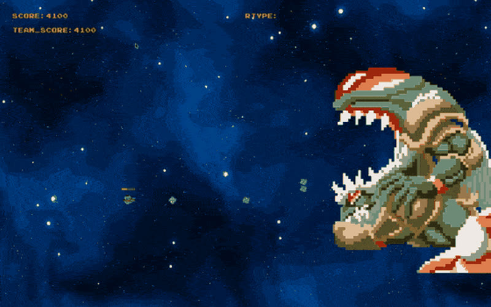
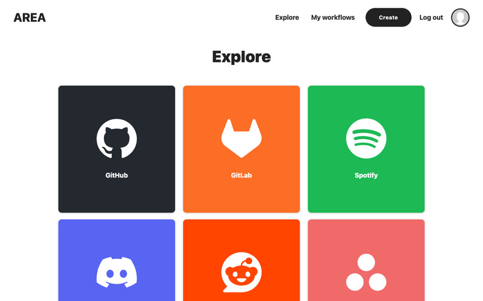
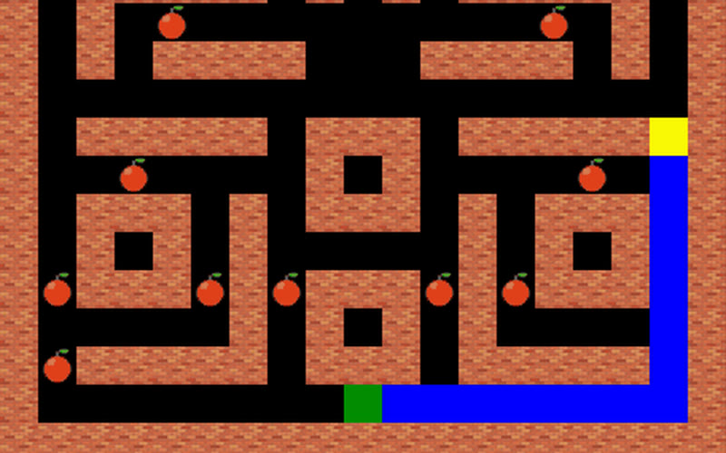
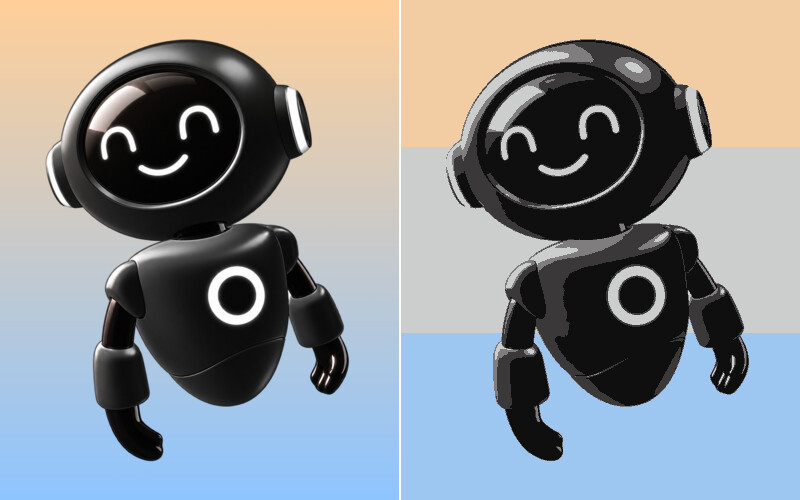
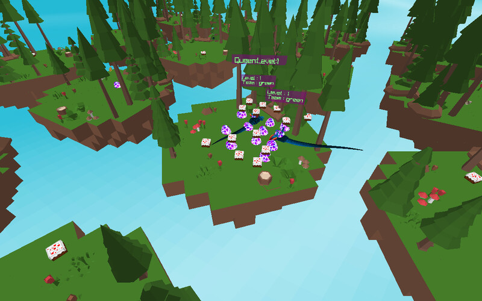
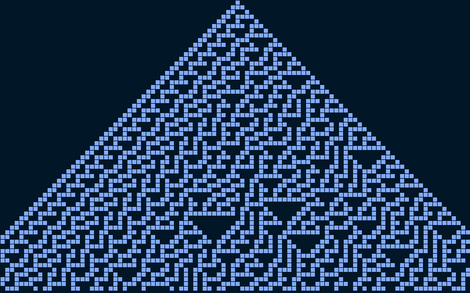

Software engineering student at [Epitech](https://www.epitech.eu/) Paris. I mostly build backends and systems software, in TypeScript, Go and C++.

💼 [LinkedIn](https://www.linkedin.com/in/yanis-harkouk) · 📍 Paris

🎮 Currently working on [**PlayForward**](https://playforward.fr): indie video game recommendations based on what you play.

#### Projects

<table>
  <tr>
    <td width="33%" valign="top">
      
       <a href="https://github.com/yanishk/R-Type"><b>R-Type</b></a>
       4-player networked shooter in C++17 on a custom ECS engine, with an authoritative UDP server.
    </td>
    <td width="33%" valign="top">
      
       <a href="https://github.com/yanishk/AREA"><b>AREA</b></a>
       IFTTT-style automation platform: Go REST API with OAuth2 for 9 providers, web and mobile clients.
    </td>
    <td width="33%" valign="top">
      
       <a href="https://github.com/yanishk/arcade"><b>arcade</b></a>
       C++ gaming platform where games and graphics libraries (SFML, SDL2, ncurses) are swapped at runtime.
    </td>
  </tr>
  <tr>
    <td width="33%" valign="top">
      
       <a href="https://github.com/yanishk/image_compressor"><b>image_compressor</b></a>
       Haskell image compressor that groups pixels into k colours with k-means clustering.
    </td>
    <td width="33%" valign="top">
      
       <a href="https://github.com/yanishk/zappy"><b>zappy</b></a>
       Multiplayer game played by AIs: C server, C++ AI clients that cooperate through broadcasts, 3D raylib viewer.
    </td>
    <td width="33%" valign="top">
      
       <a href="https://github.com/yanishk/wolfram"><b>wolfram</b></a>
       Wolfram's elementary cellular automata in Haskell: all 256 rules, with a custom first generation.
    </td>
  </tr>
</table>

Also: [**The Plazza**](https://github.com/yanishk/theplazza) (multi-process pizzeria simulation in C++) · [**42sh**](https://github.com/yanishk/42sh) (tcsh-like shell in C) · [**myteams**](https://github.com/yanishk/myteams) (Teams-like chat server and CLI client in C)

#### Stack

